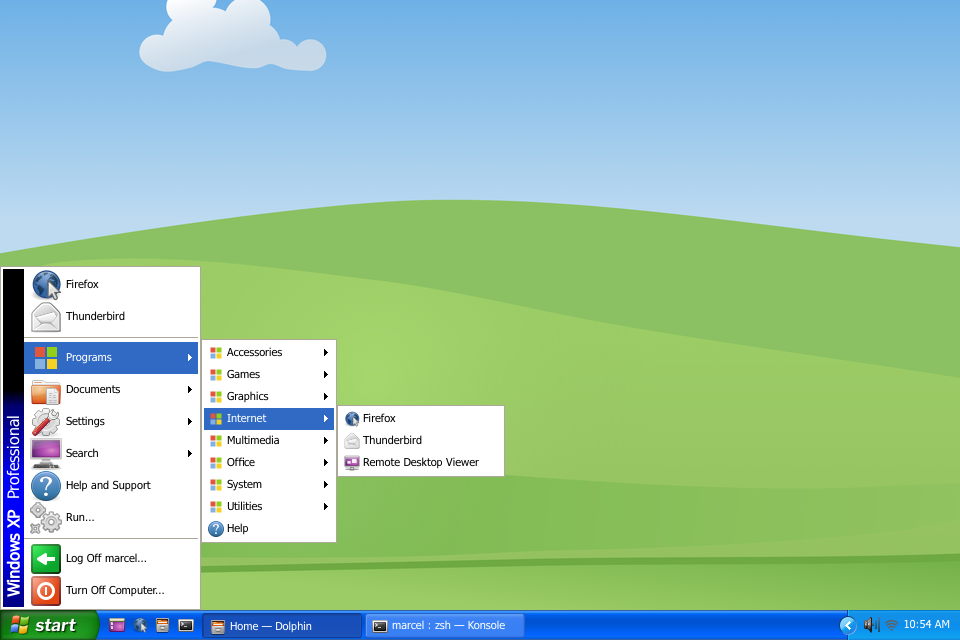
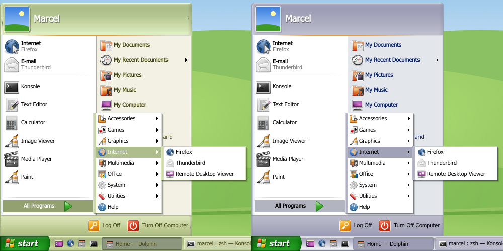

# Windows XP for KDE Plasma 6

Turns a Plasma 6 desktop into Windows XP: start button and start menu,
taskbar, notification area, Turn Off / Log Off dialogs with the grey
screen fade, XP Alt+Tab, XP cursors and Dolphin set up like XP's
Explorer, on top of the Exposé theme (window borders, Plasma theme,
application style).

The widgets take their look from the Plasma theme, as Plasma's own do:
task buttons from its task frames, the start button and the tool buttons
from its button frames, menus and cascades from its dialog frame, the
highlight, lines and arrows from its view item, line and arrow images,
and the text colours from its colour scheme. So they follow whatever
Plasma theme is chosen, Exposé or another one. XP's own artwork (the
green start button, the start menu's blue header and footer, the menus'
solid blue highlight, the cascades with their shadow, the notification
area's block and chevron, Quick Launch's hover and », the Alt+Tab box)
lives in the theme too, in `widgets/winxp.svg`. With it the taskbar is
XP's blue one under white menus, so text on the taskbar (Plasma's System
Tray included) takes the colour scheme's set for contrasting areas; a
theme without that file gets Plasma's plain look. Only the Classic
menu's banner and the Log Off / Turn Off dialogs keep XP's own colours.

Plasma's own popups (volume, network, notifications, …) get XP's look
from the same theme: white menus with black text, XP's push buttons,
text fields, check boxes, radio buttons, track bars, progress bars, tabs
and scroll bars, and pale yellow tooltips.






Rendered from the widgets' own QML with Exposé's Plasma theme, stand-in
icons and Exposé's Bløff wallpaper; with WinXPSVG and
`get-microsoft-files.sh` the icons, fonts and wallpaper are XP's.

## Install

1. Copy this repository's `home/` into your home directory:

   ```sh
   git clone https://github.com/MArpogaus/kde-plasma-winxp-launcher.git
   cd kde-plasma-winxp-launcher
   cp -r home/. ~
   ```

2. Apply the **Windows XP** Global Theme (System Settings → Colors & Themes
   → Global Theme) with *Desktop and window layout* ticked (this replaces
   your panels and desktop widgets), then log out and back in once. It
   sets up a 30 px XP taskbar (Start, Quick Launch, task buttons,
   notification area, clock), XP Alt+Tab and the cursors, on
   the look of [Exposé](https://www.opencode.net/phob1an/expose) by phob1an
   (bundled; its Plasma theme with XP replacements, see below): window
   borders, Plasma theme, colours, Kvantum style and wallpaper. [Kvantum](https://github.com/tsujan/Kvantum) is
   needed for the application style.
3. Optional, XP's other colour schemes: apply **Windows XP (Olive Green)**
   or **Windows XP (Silver)** afterwards (appearance only, they keep the
   taskbar) and pick the matching Kvantum theme, `ExposeGreen` or
   `ExposeMetallic` (Kvantum Manager, or
   `kvantummanager --set ExposeGreen`). They use phob1an's
   [Exposé Green](https://www.opencode.net/phob1an/expose-green) and
   [Exposé Metallic](https://www.opencode.net/phob1an/expose-metallic)
   (bundled) with the XP artwork recoloured to Olive Green and Silver.
4. For XP icons, install the [WinXPSVG](https://store.kde.org/p/1925937)
   icon theme: System Settings → Icons → *Get New…*, search "WinXPSVG",
   install and select it. The Global Theme leaves the icon theme alone, so
   re-applying it keeps your choice. (Exposé's login screen is not bundled
   either; *Get New…* under Login Screen.)

With its layout the Global Theme also makes Plasma behave more like XP:
desktop icons 32 px in columns from the top left, one virtual desktop, no
hot corner, no snapping windows to the screen edges, no shake-to-find
cursor, no zoom when windows open or close (minimizing still squashes into
the taskbar), animations twice as fast, clicking a scroll bar's track
pages (Kvantum styles may keep their own behaviour) and menus without
icons (in Plasma and Qt/KDE applications; GTK applications keep theirs).
Change any of them back in System Settings.

Copying also switches app launch feedback to XP's static busy cursor (no
bouncing icon, `~/.config/klaunchrc`), and it overwrites Dolphin's toolbar
(`~/.local/share/kxmlgui5/dolphin/dolphinui.rc`), Dolphin's default view and
the selected Kvantum theme (`~/.config/Kvantum/kvantum.kvconfig`).

### Original XP files (optional)

XP's fonts, sounds, Bliss and the original start flag belong to
Microsoft, so they are not part of this repository.
`./get-microsoft-files.sh` downloads them from
[xfce-winxp-tc](https://github.com/rozniak/xfce-winxp-tc) and
[Windows-XP-Sound-Theme-KDE](https://github.com/wonordel/Windows-XP-Sound-Theme-KDE)
and switches to Tahoma / Trebuchet MS, the XP sounds and Bliss. The start
button picks up XP's flag automatically.

### Uninstall

Apply Breeze (or any other) Global Theme with its desktop layout, then
remove the copied files (from this repository's directory):

```sh
(cd home && git ls-files -z) | (cd ~ && xargs -0 rm -f)
```

Files from `get-microsoft-files.sh` are in `~/.local/share/{fonts,sounds,wallpapers}/WindowsXP`
and `~/.local/share/winxp-kde`. It also set fonts and sounds; choose others
in System Settings (Text & Fonts, Sounds) or reset its settings:

```sh
for key in font menuFont toolBarFont smallestReadableFont; do
    kwriteconfig6 --file kdeglobals --group General --key "$key" --delete
done
kwriteconfig6 --file kdeglobals --group WM --key activeFont --delete
kwriteconfig6 --file kdeglobals --group Sounds --key Theme --delete
```

The Global Theme's layout also changed the behaviour settings listed under
Install; to reset them all:

```sh
for key in Number Rows; do
    kwriteconfig6 --file kwinrc --group Desktops --key "$key" --delete
done
kwriteconfig6 --file kwinrc --group Effect-overview --key BorderActivate --delete
for key in ElectricBorderMaximize ElectricBorderTiling; do
    kwriteconfig6 --file kwinrc --group Windows --key "$key" --delete
done
for key in shakecursorEnabled scaleEnabled fadeEnabled squashEnabled magiclampEnabled; do
    kwriteconfig6 --file kwinrc --group Plugins --key "$key" --delete
done
for key in AnimationDurationFactor ScrollbarLeftClickNavigatesByPage ShowIconsInMenuItems; do
    kwriteconfig6 --file kdeglobals --group KDE --key "$key" --delete
done
```

## What is in `home/`

| Part | Path | Source, license |
| --- | --- | --- |
| Start menu, Quick Launch, taskbar, notification area, clock widgets | `.local/share/plasma/plasmoids/com.github.marpogaus.*` | this repository, GPL-2.0+ |
| Fallback fonts for the start menu | `.local/share/plasma/plasmoids/com.github.marpogaus.winxpstartmenu/contents/fonts` | Wine's Tahoma (LGPL-2.1+), Libre Franklin (OFL-1.1) |
| Grey fade behind Turn Off / Log Off (KWin effect) | `.local/share/kwin/effects/winxp_sessionfade` | this repository, GPL-2.0+ |
| XP Alt+Tab (KWin window switcher) | `.local/share/kwin/tabbox/winxp_alttab` | this repository, GPL-2.0+ |
| Windows XP Global Themes (taskbar layout, Alt+Tab, cursors, Exposé look; Olive Green and Silver) | `.local/share/plasma/look-and-feel/com.github.marpogaus.winxp{,.olivegreen,.silver}` | this repository, GPL-2.0+ |
| Exposé Green and Exposé Metallic (window borders, Plasma themes, colours, Kvantum) | `.local/share/plasma/desktoptheme/{exposegreen,exposemetallic}`, `.local/share/aurorae/themes/{exposegreen,exposemetallic}`, `.local/share/color-schemes/{ExposeGreen,ExposeMetallic}.colors`, `.config/Kvantum/{ExposeGreen,ExposeMetallic}` | [Exposé Green](https://www.opencode.net/phob1an/expose-green), [Exposé Metallic](https://www.opencode.net/phob1an/expose-metallic) by phob1an, GPL-3.0 (see the bundled `LICENSE` files). Their Plasma themes' files marked "Part of the Windows XP pack" are this repository's, GPL-2.0+ |
| Exposé (window borders, Plasma theme, colours, Kvantum, wallpapers) | `.local/share/plasma/desktoptheme/expose`, `.local/share/aurorae/themes/expose`, `.local/share/color-schemes/Expose.colors`, `.config/Kvantum`, `.local/share/wallpapers/{expose,Bløff}` | [Exposé](https://www.opencode.net/phob1an/expose) by phob1an, GPL-3.0 (see the bundled `LICENSE` files); wallpapers CC BY-SA 4.0. The Plasma theme's files marked "Part of the Windows XP pack" (XP versions of Exposé's files, and `widgets/winxp.svg`) are this repository's, GPL-2.0+ |
| Cursors | `.local/share/icons/ModernXP` | [modernXP](https://github.com/na0miluv/modernXP-cursor-theme) release, unmodified, GPL-3.0 |
| Dolphin as XP Explorer | `.local/share/kxmlgui5/dolphin`, `.local/share/dolphin` | toolbar derived from [Dolphin](https://invent.kde.org/system/dolphin), GPL-2.0+ |

### Taskbar and notification area

The start button, task buttons and notification area are laid out on the
visible taskbar, not only on the space Plasma gives each widget, so they
line up like XP's whatever the panel theme's padding. Make the taskbar
taller (about 28 px per row) to get several rows of task buttons. Like XP's single taskbar
it shows the windows of all screens. Buttons shrink down to a minimum
width (80 px); windows that do not fit then are in a » menu at the end of
the taskbar (click to switch, right-click for the window menu).
Right-click a free spot → Configure for the button widths and which
windows are shown.

The notification area uses Plasma's own System Tray (so volume, network,
battery and app icons all work). Plasma gives
every panel widget at least 22 px, so tray icons are 22 px where XP had
16 px. Like XP's *Hide inactive icons*, clipboard, brightness, Bluetooth,
notifications and similar status icons start out hidden (System Tray
settings → Entries to change that); XP's round chevron at the left of the
light blue notification area shows them in the notification area itself,
as XP's did, instead of Plasma's popup.

The clock follows System Settings → Region & Language. Right-click →
Configure for XP's options: *Show the clock*, an XP style time format
(`h:mm tt`, `HH:mm`, …) with own AM/PM symbols, the long date shown as
tooltip and what double-clicking runs.

Quick Launch shows up to four 16 px icons, Show Desktop plus three launchers
(browser, file manager and Konsole by default) and puts the rest behind
a » menu. Drop applications on it (from the start menu, Dolphin or the desktop) to add
them, drag its icons to reorder them and right-click one (also in the »
menu) to remove it;
the start menu's right-click menu has *Add to Quick Launch*.
Right-click → Configure Quick Launch… for the full list and the limit.

### Dolphin as XP Explorer

Toolbar *Back · Forward · Up | Search · Folders | Views* with labels on
Back, Search and Folders, the address bar on its own row, and tiles
(compact view) with type and size. Press Ctrl+M once for the menu bar, F7
for the folder tree and Ctrl++ until the tiles reach XP's 48 px icons;
Dolphin remembers all three. XP's blue task pane has no Dolphin
counterpart.

The toolbar file is made for the Dolphin version it was taken from; a newer
Dolphin with a changed toolbar file ignores it until it is updated.

## Start menu features

- **start** button with the start icon (XP's flag once downloaded), hover
  and pressed states, sized to the panel (100 × 30 px on a 30 px panel).
  Tooltip: "Click here to begin".
- XP's layout: header with user picture and name, programs on the left,
  places on the right, Log Off / Turn Off Computer footer. Geometry measured
  from a native XP screenshot: 382 px wide, 64 px header, 40 px footer,
  36 px program rows with 32 px icons, 30 px place rows with 24 px icons.
- **Pinned programs** at the top (Internet and E-mail by default, using your
  preferred browser and mail client) and **most frequently used programs** below.
- **All Programs** cascading menus with hover-to-open delay, folder arrows and
  multi-column wrapping for long menus, just like XP.
- **My Recent Documents** cascade.
- Right-click on a program: Open, Pin to / Unpin from Start menu, Add to /
  Remove from Quick Launch, plus the usual application actions (Edit
  Application, Add to Desktop, …).
- Drag programs out of the menu onto Quick Launch, the desktop or Dolphin.
- Type while the menu is open to search (KRunner backends); results replace
  the program list, Up/Down/Enter to launch, Esc to clear.
- Meta key opens the menu (it can replace Kickoff via *Show Alternatives*).
- Log Off and Turn Off Computer open XP style Log Off / Turn Off dialogs.
- **Classic Start menu** as an option: pinned
  programs, Programs, Documents, Settings, Search, Help and Support, Run,
  Log Off, Turn Off Computer, and the "Windows XP Professional" banner
  (text configurable; hidden with small icons).

### Fonts

XP uses **Tahoma** in the menu and **Franklin Gothic Medium** on the start
button. If they are not installed the start menu falls back to bundled
look-alikes: Wine's metric-compatible Tahoma (LGPL) and Libre Franklin (OFL),
see the widget's `contents/fonts`. Both fonts are configurable.

## Configuration

Right-click the start button → *Configure Windows XP Start Menu…*

**General:** button label, icon (empty = XP's flag if downloaded, else the
theme's start icon) and fonts, and the location or command behind My Computer,
Network, Control Panel, Set Program Access and Defaults, Network
Connections, Printers and Faxes, Help and Support, Search and Run (My
Documents, Pictures and Music follow the XDG folders).

**Start Menu**, laid out like XP's Start Menu tab and its *Customize*
dialogs:

- Start menu or Classic Start menu
- Start menu, General: large or small icons, number of programs (0–30)
  and *Clear List*, Internet and E-mail on the start menu (*Choose
  Programs…* opens Plasma's default applications)
- Start menu, Advanced: open submenus when pausing on them, highlight newly
  installed programs; Control Panel, My Computer, My Documents, My Music
  and My Pictures as a link, as a menu or hidden (as a menu, folders show
  their contents and Control Panel shows KDE's Settings category); Network
  Connections as a link or hidden; show or hide Help and Support, My Network
  Places, My Recent Documents (with *Clear List*), Printers and Faxes, Run,
  Search, Set Program Access and Defaults and System Administrative Tools
  (KDE's System category)
- Classic Start menu: small icons, Display Log Off, Display Run, expand
  Control Panel, My Documents, My Music and My Pictures into submenus, the
  banner text
- both: enable dragging and dropping, scroll programs instead of wrapping
  them into columns

Not carried over from XP: the Favorites menu (Internet Explorer's
bookmarks), *Connect To* (a list of dial-up connections) and personalized
menus. Folders as menus use the desktop folder view's model, which comes
with Plasma.

## Development

- `tools/update-vendored.sh`: refreshes the third-party files in `home/`.
- Edits to widgets: copy `home/` again and restart plasmashell
  (`systemctl --user restart plasma-plasmashell`).

The start menu uses Plasma's private `org.kde.plasma.private.kicker` models
(as Kickoff and Kicker do). All artwork of the widgets and of the Plasma
theme's XP files is original, drawn after native XP screenshots; no
Microsoft assets are included in this repository.

## License

This repository's own code: GPL-2.0-or-later. Bundled third-party files:
see the table above.
