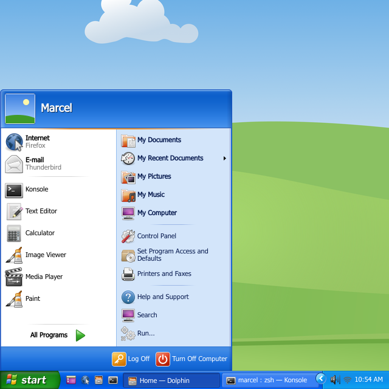
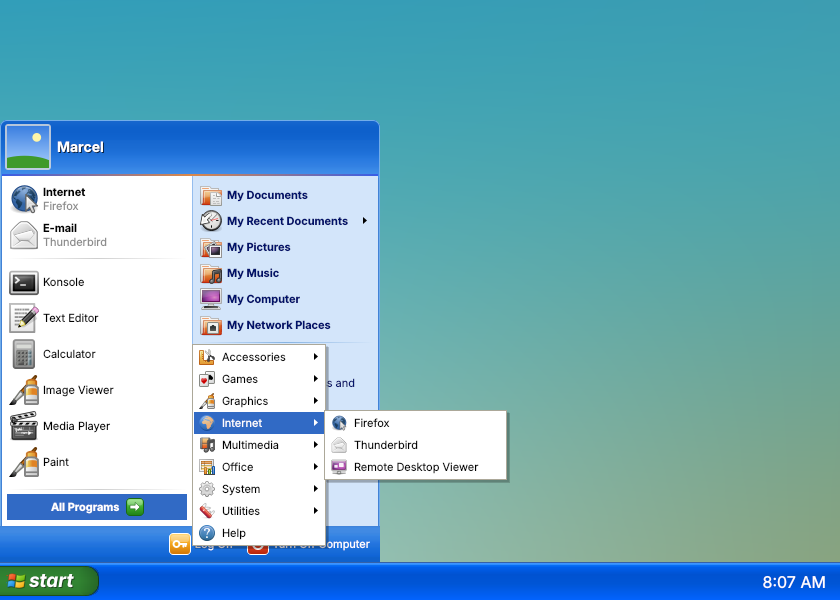

# Windows XP for KDE Plasma 6

Turns a Plasma 6 desktop into Windows XP (Luna, blue): start button and
start menu, taskbar, notification area, Turn Off / Log Off dialogs with the
grey screen fade, XP Alt+Tab, XP cursors and Dolphin set up like XP's
Explorer, on top of the Exposé theme (window borders, Plasma theme,
application style).

| Start menu | All Programs |
| --- | --- |
|  |  |

Rendered from the widgets' own QML with stand-in icons and
Exposé's Bløff wallpaper; with `get-microsoft-files.sh` the icons, fonts
and wallpaper are XP's.

## Install

1. Copy this repository's `home/` into your home directory:

   ```sh
   git clone https://github.com/MArpogaus/kde-plasma-winxp-launcher.git
   cd kde-plasma-winxp-launcher
   cp -r home/. ~
   ```

2. Apply the **Windows XP** Global Theme (System Settings → Colors & Themes
   → Global Theme) with *Use desktop layout from theme* ticked, then log out
   and back in once. It sets up a 30 px XP taskbar (Start, Quick Launch,
   task buttons, notification area, clock), XP Alt+Tab and the cursors, on
   the look of [Exposé](https://www.opencode.net/phob1an/expose) by phob1an
   (bundled unmodified): window borders, Plasma theme, colours, Kvantum
   style and wallpaper. [Kvantum](https://github.com/tsujan/Kvantum) is
   needed for the application style. Exposé's *ExposeAir* icons and login
   screen are not bundled; get them with *Get New…* in the Icons and Login
   Screen settings (or use the XP icons below). Re-applying the Global Theme
   sets the icons back to ExposeAir; run `./get-microsoft-files.sh` again
   afterwards if you use the XP icons.

Copying overwrites Dolphin's toolbar (`~/.local/share/kxmlgui5/dolphin/dolphinui.rc`),
Dolphin's default view and the selected Kvantum theme (`~/.config/Kvantum/kvantum.kvconfig`).

### Original XP files and icons (optional)

XP's fonts, icons, sounds, Bliss and the original start flag belong to
Microsoft, so they are not part of this repository.
`./get-microsoft-files.sh` downloads them from
[xfce-winxp-tc](https://github.com/rozniak/xfce-winxp-tc) and
[Windows-XP-Sound-Theme-KDE](https://github.com/wonordel/Windows-XP-Sound-Theme-KDE)
and switches to the XP icons (with Breeze for names XP has no icon for),
Tahoma / Trebuchet MS, the XP sounds and Bliss. The start button picks up
XP's flag automatically.

XP's icons are bitmaps of up to 48 px, so the Windows XP layout sets the
desktop to XP's 32 px icons, where they are sharp; larger sizes (Dolphin
zoomed in, 64 px desktop icons) are scaled up and look soft. For sharp
icons at every size, use the scalable
[WinXPSVG icon theme](https://store.kde.org/p/1925937) instead: extract it
to `~/.local/share/icons` and choose it under System Settings → Icons.

### Uninstall

Apply Breeze (or any other) Global Theme with its desktop layout, then
remove the copied files (from this repository's directory):

```sh
(cd home && git ls-files -z) | (cd ~ && xargs -0 rm -f)
```

Files from `get-microsoft-files.sh` are in `~/.local/share/{fonts,sounds,wallpapers}/WindowsXP`,
`~/.local/share/icons/WindowsXP-Luna` and `~/.local/share/winxp-kde`. It also
set fonts, icons and sounds; choose others in System Settings (Text & Fonts,
Icons, Sounds) or reset its settings:

```sh
for key in font menuFont toolBarFont smallestReadableFont; do
    kwriteconfig6 --file kdeglobals --group General --key "$key" --delete
done
kwriteconfig6 --file kdeglobals --group WM --key activeFont --delete
kwriteconfig6 --file kdeglobals --group Sounds --key Theme --delete
kwriteconfig6 --file kdeglobals --group Icons --key Theme --delete
```

## What is in `home/`

| Part | Path | Source, license |
| --- | --- | --- |
| Start menu, Quick Launch, taskbar, notification area, clock widgets | `.local/share/plasma/plasmoids/com.github.marpogaus.*` | this repository, GPL-2.0+ |
| Fallback fonts for the start menu | `.local/share/plasma/plasmoids/com.github.marpogaus.winxpstartmenu/contents/fonts` | Wine's Tahoma (LGPL-2.1+), Libre Franklin (OFL-1.1) |
| Grey fade behind Turn Off / Log Off (KWin effect) | `.local/share/kwin/effects/winxp_sessionfade` | this repository, GPL-2.0+ |
| XP Alt+Tab (KWin window switcher) | `.local/share/kwin/tabbox/winxp_alttab` | this repository, GPL-2.0+ |
| Windows XP Global Theme (taskbar layout, Alt+Tab, cursors, Exposé look) | `.local/share/plasma/look-and-feel/com.github.marpogaus.winxp` | this repository, GPL-2.0+ |
| Exposé (window borders, Plasma theme, colours, Kvantum, wallpapers) | `.local/share/plasma/desktoptheme/expose`, `.local/share/aurorae/themes/expose`, `.local/share/color-schemes/Expose.colors`, `.config/Kvantum`, `.local/share/wallpapers/{expose,Bløff}` | [Exposé](https://www.opencode.net/phob1an/expose) by phob1an, unmodified, GPL-3.0 (see the bundled `LICENSE` files); wallpapers CC BY-SA 4.0 |
| Cursors | `.local/share/icons/ModernXP` | built from [modernXP](https://github.com/na0miluv/modernXP-cursor-theme), GPL-3.0 |
| Dolphin as XP Explorer | `.local/share/kxmlgui5/dolphin`, `.local/share/dolphin` | toolbar derived from [Dolphin](https://invent.kde.org/system/dolphin), GPL-2.0+ |

`tools/update-vendored.sh` refreshes Exposé and rebuilds the cursors and
the Dolphin toolbar from upstream.

### Taskbar and notification area

The start button, task buttons and notification area are laid out on the
visible taskbar, not only on the space Plasma gives each widget, so they
line up like XP's whatever the panel theme's padding. Make the taskbar
taller (about 28 px per row) to get several rows of task buttons. Right-click a free spot →
Configure for the widest button and which windows are shown.

The notification area uses Plasma's own System Tray (so volume, network,
battery and app icons all work), on XP's light blue block. Plasma gives
every panel widget at least 22 px, so tray icons are 22 px where XP had
16 px. Like XP's *Hide inactive icons*, clipboard, brightness, Bluetooth,
notifications and similar status icons start out hidden (System Tray
settings → Entries to change that); XP's round chevron on the left shows
them in the notification area itself instead of Plasma's popup.

The clock follows System Settings → Region & Language. Right-click →
Configure for XP's options: *Show the clock*, an XP style time format
(`h:mm tt`, `HH:mm`, …) with own AM/PM symbols, the long date shown as
tooltip and what double-clicking runs.

Quick Launch shows Show Desktop plus up to four launchers as 16 px icons
(browser, file manager and Konsole by default) and puts the rest behind
a » menu. Drop applications on it (from the start menu, Dolphin or the desktop) to add
them, drag its icons to reorder them and right-click one to remove it;
the start menu's right-click menu has *Add to Quick Launch*.
Right-click → Configure Quick Launch… for the full list and the limit.

### Dolphin as XP Explorer

Toolbar *Back · Forward · Up | Search · Folders | Views* with labels on
Back, Search and Folders, the address bar on its own row, and tiles
(compact view) with type and size. Press Ctrl+M once for the menu bar, F7
for the folder tree and Ctrl++ until the tiles reach XP's 48 px icons;
Dolphin remembers all three. XP's blue task pane has no Dolphin
counterpart.

The toolbar file is made for the Dolphin version it was taken from; a newer
Dolphin with a changed toolbar file ignores it until
`tools/update-vendored.sh` refreshes it.

## Start menu features

- Green **start** button with flag, hover and pressed states, sized to the
  panel (100 × 30 px on a 30 px panel). Tooltip: "Click here to begin".
- Menu drawn pixel by pixel in its own frameless window (no Plasma dialog
  frame): rounded blue header with user picture and name, orange divider,
  white program column, light blue places column, Log Off / Turn Off Computer footer.
- Geometry and colours measured from a native XP screenshot: 382 px wide,
  63 px header, 39 px footer, 36 px program rows with 32 px icons, 30 px place
  rows with 24 px icons. Header/footer gradients are sampled row by row.
- **Pinned programs** at the top (Internet and E-mail by default, using your
  preferred browser and mail client) and **most frequently used programs** below.
- **All Programs** cascading menus with hover-to-open delay, folder arrows and
  multi-column wrapping for long menus, just like XP.
- **My Recent Documents** cascade.
- Right-click on a program: Open, Pin to / Unpin from Start menu, plus the
  usual application actions (Edit Application, Add to Desktop, …).
- Type while the menu is open to search (KRunner backends); results replace
  the program list, Up/Down/Enter to launch, Esc to clear.
- Meta key opens the menu (it can replace Kickoff via *Show Alternatives*).
- Log Off and Turn Off Computer open XP style Log Off / Turn Off dialogs.

### Fonts

XP uses **Tahoma** in the menu and **Franklin Gothic Medium** on the start
button. If they are not installed the start menu falls back to bundled
look-alikes: Wine's metric-compatible Tahoma (LGPL) and Libre Franklin (OFL),
see the widget's `contents/fonts`. Both fonts are configurable.

## Configuration

Right-click the start button → *Configure Windows XP Start Menu…*

- button label, icon (empty = XP's flag if downloaded, else the built-in one) and fonts
- number of frequently used programs; which optional entries of the right
  column are shown, like XP's *Customize Start Menu* dialog
- the location or command behind My Computer, Network, Control Panel, Set
  Program Access and Defaults, Printers and Faxes, Help and Support, Search
  and Run (My Documents, Pictures and Music follow the XDG folders)

## Development

- `tools/check-qml.py`: finds QML properties that shadow built-in ones
  (needs PySide6).
- `tools/update-vendored.sh`: refreshes the third-party files in `home/`.
- `tools/xcursor.py`, `tools/build-icon-theme.py`, `tools/patch-dolphin-ui.py`:
  helpers used by the two scripts.
- Edits to widgets: copy `home/` again and restart plasmashell
  (`systemctl --user restart plasma-plasmashell`).

The start menu uses Plasma's private `org.kde.plasma.private.kicker` models
(as Kickoff and Kicker do). All artwork of the widgets is original; no
Microsoft assets are included in this repository.

## License

This repository's own code: GPL-2.0-or-later. Bundled third-party files:
see the table above.
